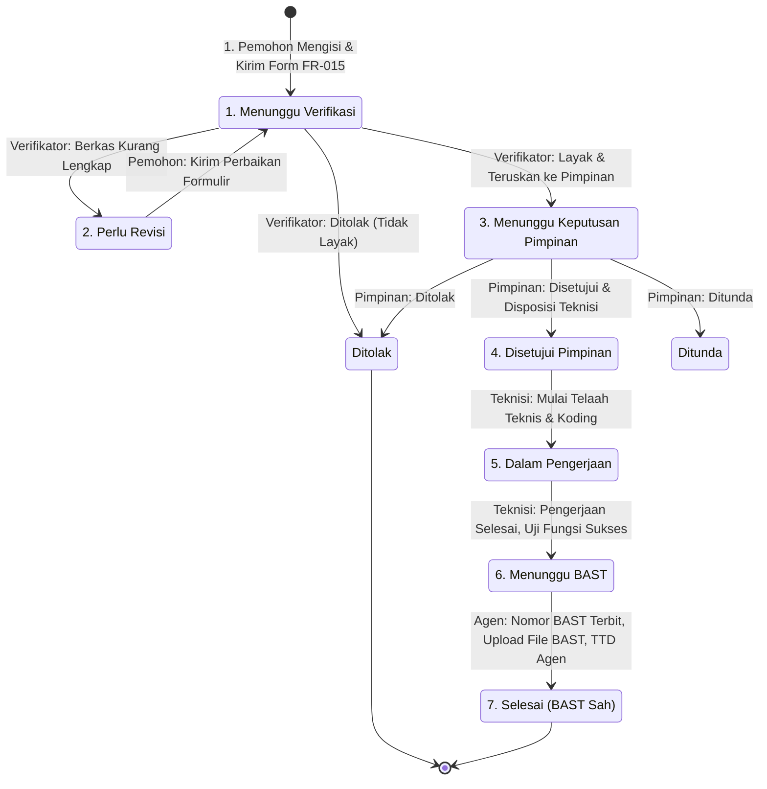

# DOKUMEN SPESIFIKASI DAN ARSITEKTUR SISTEM
# SISTEM INFORMASI PERMOHONAN REQUEST FOR CHANGE (SI-RFC)
*(Sistem Manajemen Perubahan Layanan TI Berbasis Standar ITIL / ITSM & SMKI ISO/IEC 27001 - Formulir FR-015)*

---

## 1. PENDAHULUAN & LATAR BELAKANG

### 1.1 Latar Belakang
Dalam tata kelola teknologi informasi modern pada instansi pemerintah daerah, penambahan fitur, pembaruan aplikasi, modifikasi infrastruktur, maupun perbaikan teknis (*bugfix*) sering kali diajukan oleh berbagai Organisasi Perangkat Daerah (OPD). Apabila permohonan tersebut diajukan melalui jalur informal (seperti pesan instan atau nota dinas tanpa pelacakan terpadu), tim pengelola TI menghadapi sejumlah risiko:
1. Tidak adanya rekam jejak audit (*audit trail*) terkait siapa yang meminta, memverifikasi, menyetujui, dan mengimplementasikan perubahan.
2. Tidak terukurnya analisis risiko dan dampak kegagalan terhadap sistem lain yang saling terintegrasi.
3. Sulitnya mengukur skala prioritas pekerjaan, sehingga kendala darurat (*emergency*) berpotensi tertunda.
4. Kurangnya transparansi progres status pengerjaan bagi instansi pemohon.
5. Ketiadaan Berita Acara Serah Terima (BAST) resmi sebagai bukti sah penyelesaian pekerjaan kedinasan.

### 1.2 Definisi & Standar Acuan Sistem
**Sistem Informasi Permohonan *Request for Change* (SI-RFC)** adalah platform berbasis web terintegrasi yang dirancang khusus untuk memfasilitasi siklus hidup permohonan perubahan sistem TI secara elektronik dari hulu ke hilir. Sistem ini mengadopsi standar **ITIL (*Information Technology Infrastructure Library*)**, **ISO/IEC 20000**, serta **Sistem Manajemen Keamanan Informasi (SMKI) ISO/IEC 27001** Pemerintah Provinsi Jawa Barat, khususnya mengimplementasikan secara penuh formulir standar **FR-015 (Formulir Perubahan TI)**.

---

## 2. STRUKTUR ALUR KERJA (WORKFLOW) 5 TAHAPAN & AKTOR SISTEM

Sistem menerapkan prinsip pemisahan wewenang (*separation of duties*) dengan alur kerja yang terbagi secara ketat ke dalam **5 Tahapan Berurutan**:

$$\mathbf{Pemohon} \xrightarrow{\quad\text{FR-015}\quad} \mathbf{Verifikator} \xrightarrow{\quad\text{Rekomendasi}\quad} \mathbf{Keputusan\ Pimpinan} \xrightarrow{\quad\text{Disposisi}\quad} \mathbf{Telaah\ Teknis\ \&\ Implementasi} \xrightarrow{\quad\text{Pengujian}\quad} \mathbf{BAST\ \&\ Selesai}$$

```
 ┌─────────────────────────────────────────────────────────────────────────────┐
 │                      WORKFLOW TIKET RFC (FR-015)                            │
 └─────────────────────────────────────────────────────────────────────────────┘
                                       │
                                       ▼
  ┌───────────────────────────────────────────────────────────────────────────┐
  │ 1. TAHAP PEMOHON (Requester OPD)                                          │
  │    • Mengisi Formulir Standar FR-015 secara lengkap                       │
  │    • Mengunggah berkas lampiran pendukung & TTD Digital Pemohon           │
  │    • Status: "MENUNGGU VERIFIKASI" (menunggu_verifikasi)                  │
  │    • Otorisasi FR-015: "Dibuat Oleh: Pemohon"                             │
  └───────────────────────────────────────────────────────────────────────────┘
                                       │
                                       ▼
  ┌───────────────────────────────────────────────────────────────────────────┐
  │ 2. TAHAP VERIFIKATOR (Koordinator Agen / Analis Sistem APTIKA)            │
  │    • Memeriksa kelayakan administratif, dokumen, & kriteria risiko        │
  │    • Menetapkan Skala Prioritas Resmi (P1-Kritis / P2 / P3 / P4)          │
  │    • Keputusan Verifikasi:                                                │
  │      ├─ [Perlu Revisi] ────> Kembalikan ke Pemohon untuk diperbaiki       │
  │      ├─ [Tolak] ───────────> Permohonan ditolak pada tahap telaah awal    │
  │      └─ [Lanjut Pimpinan] ─> Diteruskan ke meja persetujuan Kabid         │
  │    • Status: "MENUNGGU KEPUTUSAN PIMPINAN"                                │
  │    • Otorisasi FR-015: "Diterima Oleh: Koordinator Agen"                  │
  └───────────────────────────────────────────────────────────────────────────┘
                                       │
                                       ▼
  ┌───────────────────────────────────────────────────────────────────────────┐
  │ 3. TAHAP KEPUTUSAN PIMPINAN (Penanggung Jawab Perangkat / Kabid APTIKA)   │
  │    • Mengevaluasi telaah verifikator dan dampak strategis sistem          │
  │    • Memberikan Keputusan Final: [Disetujui / Ditolak / Ditunda]          │
  │    • Menetapkan Disposisi Tim/Teknisi Pelaksana & Target Batas Waktu      │
  │    • Status: "DISETUJUI" (disetujui)                                      │
  │    • Otorisasi FR-015: "Disetujui Oleh: Penanggung Jawab Perangkat"       │
  └───────────────────────────────────────────────────────────────────────────┘
                                       │
                                       ▼
  ┌───────────────────────────────────────────────────────────────────────────┐
  │ 4. TAHAP TELAAH TEKNIS & IMPLEMENTASI (Tim Pengembang / Agen Pelaksana)   │
  │    • Analisis arsitektur sistem, modul terdampak, & dependensi basis data │
  │    • Melaksanakan koding, konfigurasi server, deployment, atau bugfix     │
  │    • Mencatat changelog, tautan git repository/commit, & log teknis       │
  │    • Pengujian fungsi (functional testing) & verifikasi kesiapan sistem   │
  │    • Status: "DALAM PENGERJAAN" ──> "MENUNGGU BAST"                       │
  └───────────────────────────────────────────────────────────────────────────┘
                                       │
                                       ▼
  ┌───────────────────────────────────────────────────────────────────────────┐
  │ 5. TAHAP BAST & PENYELESAIAN RESMI (Dilaksanakan Oleh: Agen)              │
  │    • Penerbitan Nomor Berita Acara Serah Terima (BAST) resmi kedinasan    │
  │    • Pengunggahan dokumen sah BAST & TTD Digital Agen Pelaksana           │
  │    • Serah terima hasil perubahan kepada PIC Pemohon OPD                  │
  │    • Status: "SELESAI" (selesai)                                          │
  │    • Otorisasi FR-015: "Dilaksanakan Oleh: Agen"                          │
  └───────────────────────────────────────────────────────────────────────────┘
```

### 2.1 Matriks Peran & Tanggung Jawab (*Role Responsibility Matrix*)

| No | Peran / Aktor | Entitas Pengguna | Tanggung Jawab Utama | Pengesahan Dokumen FR-015 |
| :---: | :--- | :--- | :--- | :--- |
| **1** | **Pemohon (*Requester*)** | Staf / PIC TI Organisasi Perangkat Daerah (OPD) | Mengisi formulir FR-015, mengunggah nota dinas/lampiran, menandatangani form pengajuan, melacak tiket, serta melakukan revisi jika diminta verifikator. | **Kotak 1: Dibuat Oleh Pemohon** |
| **2** | **Verifikator (*Technical Reviewer*)** | Analis Sistem / Staf Layanan TI (Koordinator Agen) | Verifikasi kelengkapan berkas, analisis kelayakan teknis, penentuan skala prioritas (P1-P4), membubuhkan catatan telaah awal dan rekomendasi ke pimpinan. | **Kotak 2: Diterima Oleh Koordinator Agen** |
| **3** | **Pengambil Keputusan (*Approver*)** | Kepala Bidang APTIKA / Penanggung Jawab Perangkat | Evaluasi strategis, pengesahan persetujuan permohonan, penentuan target deadline, dan disposisi penugasan kepada tim teknisi pelaksana. | **Kotak 3: Disetujui Oleh Penanggung Jawab Perangkat** |
| **4** | **Teknisi Pelaksana (*Engineer / Developer*)** | Software Engineer, Database Administrator, NetOps | Melakukan telaah teknis mendalam sistem, eksekusi pengerjaan teknis perubahan, pencatatan log implementasi, dan pengujian fungsi. | **Pelaksana Teknis Perubahan** |
| **5** | **Agen Pelaksana & Serah Terima (*BAST Officer*)** | Koordinator Teknis / Pejabat Penyerah Hasil Layanan | Menerbitkan nomor BAST resmi, mengunggah dokumen BAST final yang telah ditandatangani, dan menutup tiket RFC menjadi status selesai. | **Kotak 4: Dilaksanakan Oleh Agen** |

---

## 3. FORMULIR INPUT STANDAR RESMI: FR-015 FORMULIR PERUBAHAN TI

Formulir input pada antarmuka web (Frontend) dirancang **persis mengikuti format tabel asli dokumen SMKI FR-015**:

```
┌───────────────────────────────────────────────────────────────────────────────────────────────────────────┐
│ No. RFC: [ RFC-YYYY-XXXX (Auto-Generated) ]                                                              │
├───────────────────────────────────────────────────────────────────────────────────────────────────────────┤
│ INFORMASI PEMOHON                                                                                         │
├─────────────────────────────┬─────────────────────────────────────────────────────────────────────────────┤
│ Pemohon                     │ [ Nama Lengkap Pemohon / NIP ]                                              │
├─────────────────────────────┼─────────────────────────────────────────────────────────────────────────────┤
│ Unit Kerja                  │ [ Nama Bidang / Seksi / Unit Kerja ]                                        │
├─────────────────────────────┼─────────────────────────────────────────────────────────────────────────────┤
│ Perangkat Daerah            │ [ Pilihan Organisasi Perangkat Daerah / OPD ]                               │
├─────────────────────────────┼─────────────────────────────────────────────────────────────────────────────┤
│ Nomor Surat/Contact Person  │ [ Nomor Surat Kedinasan & Nomor Telepon/WhatsApp Aktif ]                    │
├─────────────────────────────┴─────────────────────────────────────────────────────────────────────────────┤
│ INFORMASI DATA                                                                                            │
├─────────────────────────────┬─────────────────────────────────────────────────────────────────────────────┤
│ Jenis Perubahan             │ [ ] Permintaan Baru    [ ] Peningkatan Sistem    [ ] Perbaikan Sistem       │
├─────────────────────────────┼─────────────────────────────────────────────────────────────────────────────┤
│ Perubahan yang diharapkan   │ [ Deskripsi ringkas fungsionalitas / hasil perubahan yang diinginkan ]      │
├─────────────────────────────┼─────────────────────────────────────────────────────────────────────────────┤
│ Latar belakang perubahan    │ [ Alasan, dasar hukum/kebijakan, atau urgensi perlunya perubahan ]          │
├─────────────────────────────┼─────────────────────────────────────────────────────────────────────────────┤
│ Rincian atas perubahan      │ [ Uraian teknis modul, tabel database, field, antarmuka, atau endpoint ]    │
│ yang diajukan               │                                                                             │
├─────────────────────────────┼─────────────────────────────────────────────────────────────────────────────┤
│ Risiko terkait bila         │ Kriteria:                                                                   │
│ perubahan tidak dilakukan   │ [ ] Malapetaka   [ ] Sangat Berat   [ ] Berat   [ ] Agak Berat   [ ] Tidak   │
│                             │                                                                      Berat │
│                             │ Keterangan: [ Uraian konsekuensi bila permohonan tidak dikerjakan ]         │
├─────────────────────────────┼─────────────────────────────────────────────────────────────────────────────┤
│ Solusi yang diharapkan      │ [ Usulan solusi teknis atau metode pengerjaan yang diharapkan ]             │
├─────────────────────────────┼─────────────────────────────────────────────────────────────────────────────┤
│ Risiko Perubahan            │ [ Potensi dampak negatif saat implementasi berlangsung, misal downtime ]    │
├─────────────────────────────┼─────────────────────────────────────────────────────────────────────────────┤
│ Alternatif Perubahan        │ [ Opsi alternatif lain bila perubahan utama terkendala anggaran/waktu ]     │
├─────────────────────────────┼─────────────────────────────────────────────────────────────────────────────┤
│ Biaya Perubahan             │ [ Estimasi biaya perubahan (Rp 0 bila fasilitasi internal Pemprov) ]        │
├─────────────────────────────┼─────────────────────────────────────────────────────────────────────────────┤
│ Waktu Perubahan             │ [ Estimasi durasi waktu implementasi, misal 7 Hari Kerja ]                  │
├─────────────────────────────┼─────────────────────────────────────────────────────────────────────────────┤
│ Lampiran                    │ [ Berkas Dokumen Pendukung: PDF, DOCX, ZIP, PNG, JPG (Maks. 5 file) ]       │
├─────────────────────────────┴─────────────────────────────────────────────────────────────────────────────┤
│ MATRIKS PENGESAHAN OTORISASI (4 KOTAK STANDAR FR-015)                                                     │
├───────────────────────────────────────────┬───────────────────────────────────────────────────────────────┤
│ Tanggal: [ YYYY-MM-DD ]                   │ Tanggal: [ YYYY-MM-DD ]                                       │
│ Dibuat Oleh:                              │ Diterima Oleh:                                                │
│ Pemohon,                                  │ Koordinator Agen,                                             │
│                                           │                                                               │
│       [ Goresan TTD Digital ]             │       [ Goresan TTD Digital ]                                 │
│                                           │                                                               │
│ (………………………………………………………………)                 │ (………………………………………………………………)                                         │
├───────────────────────────────────────────┼───────────────────────────────────────────────────────────────┤
│ Tanggal: [ YYYY-MM-DD ]                   │ Tanggal: [ YYYY-MM-DD ]                                       │
│ Disetujui Oleh:                           │ Dilaksanakan Oleh:                                            │
│ Penanggung Jawab Perangkat,               │ Agen,                                                         │
│                                           │                                                               │
│       [ Goresan TTD Digital ]             │       [ Goresan TTD Digital ]                                 │
│                                           │                                                               │
│ (………………………………………………………………)                 │ (………………………………………………………………)                                         │
└───────────────────────────────────────────┴───────────────────────────────────────────────────────────────┘
```

---

## 4. TATA KELOLA SKALA PRIORITAS & SLA VERIFIKASI

Pada tahap verifikasi, berkas dinilai berdasarkan matriks dampak dan urgensi:

$$\mathbf{Prioritas} = \mathbf{Tingkat\ Dampak\ (Impact)} \times \mathbf{Tingkat\ Urgensi\ (Urgency)}$$

### 4.1 Matriks Prioritas & Waktu Tanggap (SLA)

| Tingkat Prioritas | Bobot Warna | Kriteria Kondisi | Target Waktu Tanggap Verifikasi (SLA) |
| :--- | :---: | :--- | :---: |
| **P1 - Kritis (*Emergency*)** | 🔴 Merah | Dampak Luas & Urgensi Kritis (*System Down* / Celah Keamanan Fatal) | $\le$ **2 - 4 Jam** |
| **P2 - Tinggi (*High*)** | 🟠 Oranye | Dampak Luas dengan Urgensi Sedang, atau Sebaliknya | $\le$ **24 Jam (1 Hari)** |
| **P3 - Sedang (*Medium*)** | 🟡 Kuning | Modifikasi fungsional operasional standar tanpa gangguan fatal | $\le$ **2 - 3 Hari Kerja** |
| **P4 - Rendah (*Low*)** | 🟢 Hijau | Modifikasi tampilan minor, perbaikan teks, atau dokumentasi sistem | $\le$ **5 Hari Kerja** |

> **Ketentuan *Priority Override***: Verifikator berhak melakukan koreksi (*override*) atas prioritas yang diajukan pemohon dengan menyertakan pertimbangan teknis resmi pada lembar telaah.

---

## 5. DIAGRAM STATUS TIKET (*RFC STATE MACHINE*)



---

## 6. SPESIFIKASI RUANG KERJA (WORKSPACE) SETIAP AKTOR

### 6.1 Ruang Kerja Pemohon (*Requester Portal*)
* **Rute Frontend**: `/form-perubahan-it` & `/form-perubahan-it/ticket/[rfc]`
* **Fitur Utama**:
  1. **Formulir Pengajuan FR-015**:
     * Lengkap dengan validasi data pemohon, 3 jenis perubahan, kriteria risiko SMKI, estimasi waktu/biaya, multi upload lampiran (maks 5 berkas), dan kanvas tanda tangan digital (*signature pad*).
  2. **Pelacakan Live Stepper 5 Tahap**:
     * Visualisasi tahapan dari Pemohon, Verifikator, Pimpinan, Telaah Teknis, hingga BAST.
  3. **Panel Notifikasi Revisi**:
     * Menampilkan catatan perbaikan dari verifikator secara jelas, disertai modal formulir perbaikan agar pemohon dapat segera mengoreksi dan mengajukan ulang.
  4. **Tampilan Matriks Otorisasi FR-015**:
     * Menampilkan status pengesahan dari ke-4 pihak beserta tanggal dan paraf digitalnya.

### 6.2 Ruang Kerja Verifikator (*Technical Verifier Workspace*)
* **Rute Frontend**: `/form-perubahan-it/pengerjaan/[rfc]` (Tab Verifikasi)
* **Fitur Utama**:
  1. **Panel Reviu Administratif**: Memeriksa surat dinas, kontak PIC, dan berkas lampiran.
  2. **Penetapan Skala Prioritas**: Memilih tingkat P1 (Kritis), P2 (Tinggi), P3 (Sedang), atau P4 (Rendah) serta batas waktu SLA tanggap.
  3. **Modal Keputusan Verifikasi**:
     * *Teruskan ke Pimpinan*: Melampirkan rekomendasi teknis & membubuhkan tanda tangan Koordinator Agen.
     * *Minta Revisi*: Menuliskan instruksi perbaikan konkret yang otomatis memicu status `perlu_revisi` pada pemohon.
     * *Tolak Permohonan*: Menghentikan permohonan dengan alasan ketidaklayakan teknis.

### 6.3 Ruang Kerja Keputusan Pimpinan (*Executive Approval Board*)
* **Rute Frontend**: `/form-perubahan-it/pengerjaan/[rfc]` (Tab Keputusan Pimpinan)
* **Fitur Utama**:
  1. **Ringkasan Eksekutif Permohonan**: Intisari perubahan sistem, nama OPD, kriteria risiko, dan catatan telaah verifikator.
  2. **Aksi Pimpinan (Kabid APTIKA)**:
     * **Disetujui**: Memilih tim/teknisi yang ditugaskan (*disposisi*), menentukan target deadline pengerjaan, membubuhkan catatan arahan, dan tanda tangan digital pimpinan.
     * **Ditolak**: Membatalkan permohonan dengan dasar kebijakan resmi.
     * **Ditunda**: Menjadwalkan ulang pengerjaan pada anggaran/periode mendatang.

### 6.4 Ruang Kerja Telaah Teknis & Implementasi (*Developer Workspace*)
* **Rute Frontend**: `/form-perubahan-it/pengerjaan/[rfc]` (Tab Telaah & Koding)
* **Fitur Utama**:
  1. **Lembar Telaah Teknis**: Mencatat analisis arsitektur aplikasi, tabel database yang terdampak, dependensi pustaka, dan rencana pengujian.
  2. **Log Implementasi & Git Commit**: Mencatat riwayat implementasi teknis, modul yang diubah, dan tautan repositori GitLab kedinasan.
  3. **Manajemen Progres**: Mengubah status dari `dalam_pengerjaan` menjadi `menunggu_bast` setelah pengujian fungsi berhasil dilakukan.

### 6.5 Ruang Kerja BAST & Penyelesaian (*BAST & Closure Workspace*)
* **Rute Frontend**: `/form-perubahan-it/pengerjaan/[rfc]` (Tab BAST & Lampiran)
* **Fitur Utama**:
  1. **Penerbitan Nomor BAST**: Mencatat nomor registrasi berita acara serah terima resmi (contoh: `005/BAST-RFC/APTIKA/2026`).
  2. **Unggah Dokumen BAST**: Mengunggah berkas PDF BAST yang telah ditandatangani kedua belah pihak.
  3. **Pengesahan Agen Pelaksana**: Membubuhkan nama agen dan tanda tangan digital pada kotak otorisasi ke-4 FR-015, sekaligus menutup tiket menjadi `selesai`.

---

## 7. RANCANGAN SKEMA BASIS DATA TERSTRUKTUR (*DATABASE SCHEMA*)

Skema basis data dirancang untuk mendukung penuh data formulir FR-015, 5 tahapan workflow, 4 blok otorisasi tanda tangan, dan rekam jejak audit (*audit trail*):

```sql
-- ============================================================
-- 1. TABEL UTAMA: PERMOHONAN TI / RFC (FR-015)
-- ============================================================
CREATE TABLE permohonan_tis (
    id BIGINT UNSIGNED AUTO_INCREMENT PRIMARY KEY,
    no_rfc VARCHAR(50) UNIQUE NOT NULL,                  -- Contoh: RFC-2026-0001
    
    -- BAGIAN 1: INFORMASI PEMOHON (FR-015)
    pemohon VARCHAR(255) NOT NULL,                       -- Nama Lengkap Pemohon
    unit_kerja VARCHAR(255) NOT NULL,                    -- Unit Kerja / Bidang
    perangkat_daerah_id BIGINT UNSIGNED NULL,            -- Relasi ke Master OPD
    nama_perangkat_daerah VARCHAR(255) NULL,             -- Nama OPD
    nomor_kontak VARCHAR(100) NOT NULL,                  -- Nomor Surat / Contact Person
    email_dinas VARCHAR(255) NOT NULL,                   -- Email Dinas Resmi
    tanggal_permohonan DATE NOT NULL,                    -- Tanggal Pengajuan Form
    
    -- BAGIAN 2: INFORMASI DATA PERUBAHAN (FR-015)
    jenis_perubahan JSON NOT NULL,                       -- ['Permintaan Baru', 'Peningkatan Sistem', 'Perbaikan Sistem']
    perubahan_diharapkan TEXT NOT NULL,                  -- Perubahan yang diharapkan
    latar_belakang TEXT NOT NULL,                        -- Latar belakang perubahan
    rincian_perubahan TEXT NOT NULL,                     -- Rincian atas perubahan yang diajukan
    
    -- Analisis Risiko SMKI FR-015
    risiko_tidak_dilakukan TEXT NULL,                    -- Risiko bila perubahan tidak dilakukan
    kriteria_risiko JSON NULL,                           -- ['Malapetaka'/'Sangat Berat'/'Berat'/'Agak Berat'/'Tidak Berat']
    keterangan TEXT NULL,                                -- Keterangan tingkat risiko
    solusi_diharapkan TEXT NULL,                         -- Solusi yang diharapkan
    risiko_perubahan TEXT NULL,                          -- Risiko pelaksanaan perubahan
    alternatif_perubahan TEXT NULL,                      -- Alternatif perubahan
    biaya_perubahan VARCHAR(100) NULL,                   -- Estimasi biaya perubahan
    waktu_perubahan VARCHAR(100) NULL,                   -- Estimasi durasi waktu pengerjaan
    
    -- Identitas Aplikasi Kedinasan
    nama_aplikasi VARCHAR(255) NULL,
    deskripsi_aplikasi TEXT NULL,
    alamat_aplikasi VARCHAR(255) NULL,
    alamat_repository VARCHAR(255) NULL,
    
    -- Berkas Lampiran & Otorisasi Pemohon (Kotak 1)
    dokumen_pendukung_file JSON NULL,                    -- Array file lampiran pemohon (maks 5)
    tanda_tangan_file VARCHAR(255) NULL,                 -- File TTD Pemohon (Dibuat Oleh)
    
    -- KONTROL STATUS & SKALA PRIORITAS
    status ENUM(
        'menunggu_verifikasi',
        'perlu_revisi',
        'menunggu_keputusan_pimpinan',
        'disetujui',
        'dalam_pengerjaan',
        'menunggu_bast',
        'selesai',
        'ditolak',
        'ditunda'
    ) DEFAULT 'menunggu_verifikasi',
    prioritas ENUM('P1 - Kritis', 'P2 - Tinggi', 'P3 - Sedang', 'P4 - Rendah') DEFAULT 'P3 - Sedang',
    target_sla DATETIME NULL,                            -- Target batas tanggap SLA Verifikator
    catatan_revisi TEXT NULL,                            -- Catatan perbaikan bila perlu revisi
    
    -- TAHAP 2: VERIFIKATOR (KOORDINATOR AGEN - KOTAK 2)
    verifikator_nama VARCHAR(255) NULL,
    verifikator_catatan TEXT NULL,
    verifikator_rekomendasi ENUM('lanjut_pimpinan', 'perlu_revisi', 'tolak') NULL,
    verifikator_tanggal DATE NULL,
    verifikator_ttd VARCHAR(255) NULL,                   -- File TTD Koordinator Agen (Diterima Oleh)
    
    -- TAHAP 3: KEPUTUSAN PIMPINAN (PENANGGUNG JAWAB - KOTAK 3)
    pimpinan_nama VARCHAR(255) NULL,
    pimpinan_keputusan ENUM('disetujui', 'ditolak', 'ditunda') NULL,
    pimpinan_catatan TEXT NULL,
    pimpinan_tanggal DATE NULL,
    pimpinan_ttd VARCHAR(255) NULL,                      -- File TTD Pimpinan (Disetujui Oleh)
    assigned_to VARCHAR(255) NULL,                       -- Disposisi Tim/Teknisi yang ditugaskan
    target_deadline DATE NULL,                           -- Batas waktu penyelesaian dari Pimpinan
    
    -- TAHAP 4: TELAAH TEKNIS & IMPLEMENTASI (TEKNISI / PELAKSANA)
    teknisi_nama VARCHAR(255) NULL,                      -- PIC Teknisi Pelaksana
    telaah_teknis TEXT NULL,                             -- Catatan telaah arsitektur teknis
    catatan_implementasi TEXT NULL,                      -- Rincian changelog pengerjaan teknis
    tautan_perubahan VARCHAR(255) NULL,                  -- Tautan commit git repository
    tgl_mulai_pengerjaan DATE NULL,
    tgl_selesai_pengerjaan DATE NULL,
    
    -- TAHAP 5: BAST & PENYELESAIAN (AGEN - KOTAK 4)
    nomor_bast VARCHAR(100) NULL,                        -- Nomor Berita Acara Serah Terima
    tanggal_bast DATE NULL,                              -- Tanggal Penyerahan BAST
    file_bast VARCHAR(255) NULL,                         -- Berkas dokumen PDF BAST sah
    catatan_bast TEXT NULL,                              -- Catatan serah terima
    agen_nama VARCHAR(255) NULL,                         -- Nama Agen Pelaksana
    agen_ttd VARCHAR(255) NULL,                          -- File TTD Agen (Dilaksanakan Oleh)
    
    bidang_id BIGINT UNSIGNED NULL,
    created_at TIMESTAMP DEFAULT CURRENT_TIMESTAMP,
    updated_at TIMESTAMP DEFAULT CURRENT_TIMESTAMP ON UPDATE CURRENT_TIMESTAMP,
    INDEX idx_no_rfc (no_rfc),
    INDEX idx_status (status),
    INDEX idx_prioritas (prioritas)
);

-- ============================================================
-- 2. TABEL REKAM JEJAK AUDIT (AUDIT TRAIL / LOG RIWAYAT RFC)
-- ============================================================
CREATE TABLE permohonan_ti_histories (
    id BIGINT UNSIGNED AUTO_INCREMENT PRIMARY KEY,
    permohonan_ti_id BIGINT UNSIGNED NOT NULL,
    actor_name VARCHAR(255) NOT NULL,                    -- Nama pengguna yang melakukan aksi
    actor_role VARCHAR(50) NOT NULL,                    -- pemohon, verifikator, approver, teknisi, admin
    status_sebelumnya VARCHAR(50) NULL,
    status_baru VARCHAR(50) NOT NULL,
    keterangan VARCHAR(255) NOT NULL,                    -- Ringkasan tindakan (misal: "Disetujui Pimpinan")
    catatan TEXT NULL,                                   -- Catatan telaah / alasan tindakan
    created_at TIMESTAMP DEFAULT CURRENT_TIMESTAMP,
    updated_at TIMESTAMP DEFAULT CURRENT_TIMESTAMP ON UPDATE CURRENT_TIMESTAMP,
    FOREIGN KEY (permohonan_ti_id) REFERENCES permohonan_tis(id) ON DELETE CASCADE,
    INDEX idx_history_rfc (permohonan_ti_id)
);
```

---

## 8. SPESIFIKASI RUTE REST API TERINTEGRASI

Seluruh rute REST API diselaraskan untuk melayani setiap tahapan siklus hidup permohonan:

| No | Metode HTTP | Endpoint URL | Aktor / Otorisasi | Fungsi & Penanganan Sistem |
| :---: | :---: | :--- | :--- | :--- |
| **1** | `GET` | `/api/form-perubahan-it` | Publik / Admin | Mengambil daftar tiket RFC (mendukung filter `search`, `status`, dan sorting). |
| **2** | `GET` | `/api/form-perubahan-it/opd` | Publik | Mengambil daftar referensi resmi Organisasi Perangkat Daerah (OPD). |
| **3** | `POST` | `/api/form-perubahan-it` | **Pemohon** | **Tahap 1**: Menyimpan pengajuan form FR-015, generate nomor RFC, simpan TTD pemohon, status awal `menunggu_verifikasi`. |
| **4** | `GET` | `/api/form-perubahan-it/ticket/{rfc}` | Publik / Pemohon | Mengambil rincian lengkap tiket RFC berdasarkan nomor tiket beserta riwayat (*histories*) & URLs media. |
| **5** | `POST` | `/api/form-perubahan-it/{id}/revisi` | **Pemohon** | Mengirimkan formulir perbaikan jika status tiket berada dalam kondisi `perlu_revisi`. |
| **6** | `POST` | `/api/form-perubahan-it/{id}/verifikasi` | **Verifikator** | **Tahap 2**: Menyimpan hasil verifikasi berkas, penetapan skala prioritas (P1-P4), catatan telaah, TTD Koordinator Agen, dan mengubah status ke `menunggu_keputusan_pimpinan` / `perlu_revisi` / `ditolak`. |
| **7** | `POST` | `/api/form-perubahan-it/{id}/keputusan-pimpinan` | **Keputusan Pimpinan** | **Tahap 3**: Pengesahan Kabid APTIKA (Setujui/Tolak/Tunda), penugasan teknisi pelaksana, batas waktu (*deadline*), catatan arahan, dan TTD Penanggung Jawab. |
| **8** | `POST` | `/api/form-perubahan-it/{id}/telaah-teknis` | **Teknisi Pelaksana** | **Tahap 4**: Mencatat telaah arsitektur teknis, catatan koding implementasi, tautan git repository/commit, dan pembaruan progres (`dalam_pengerjaan` / `menunggu_bast`). |
| **9** | `POST` | `/api/form-perubahan-it/{id}/bast` | **Agen Pelaksana** | **Tahap 5**: Penerbitan Nomor BAST, unggah dokumen PDF BAST resmi, TTD Agen Pelaksana, dan penutupan tiket menjadi `selesai`. |
| **10** | `PATCH` | `/api/form-perubahan-it/{id}/status` | Admin | Pembaruan status administratif secara fleksibel disertai pencatatan riwayat audit. |
| **11** | `PATCH` | `/api/form-perubahan-it/{id}/assign` | Admin | Pembaruan penugasan tim pelaksana (*assigned_to*) secara langsung. |

---

## 9. KEPATUHAN SMKI ISO/IEC 27001 & TATA KELOLA KEDINASAN

Implementasi sistem ini menjamin kepatuhan audit keamanan informasi pemerintah daerah:
1. **Integritas Formulir FR-015**: Tidak ada field formulir fisik yang dihilangkan; seluruh klausul informasi pemohon, data perubahan, analisis risiko, dan otorisasi 4 pihak terpenuhi secara digital.
2. **Keabsahan Otorisasi 4 Pihak**: Setiap tahap mensyaratkan nama jelas pejabat dan tanda tangan digital terotentikasi yang disimpan permanen pada basis data dan dapat dicetak sewaktu-waktu.
3. **Akuntabilitas Rekam Jejak (*Audit Trail*)**: Setiap transisi status dicatat dalam tabel `permohonan_ti_histories` mencakup nama aktor, peran kedinasan, timestamp, status sebelumnya, status baru, dan catatan resmi.
4. **Kepastian Serah Terima Hukum (BAST)**: Penutupan tiket RFC secara mutlak memerlukan bukti dokumen Berita Acara Serah Terima (BAST) yang sah, melindungi penyelenggara layanan TI dari sengketa hasil pengerjaan.
